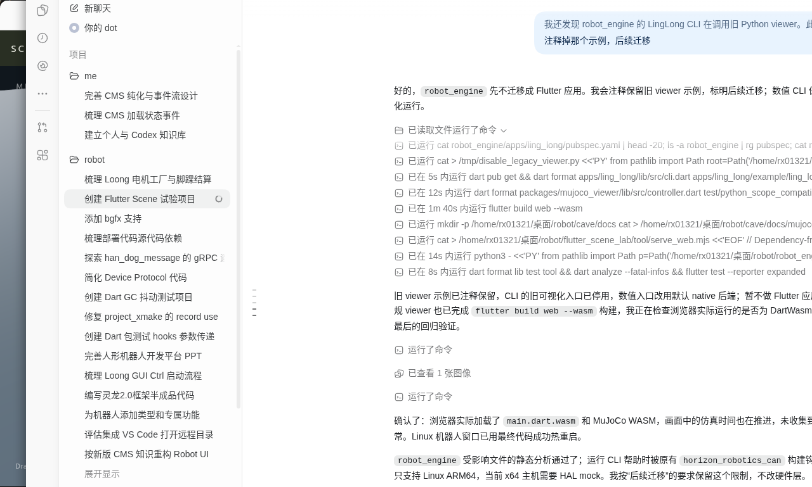
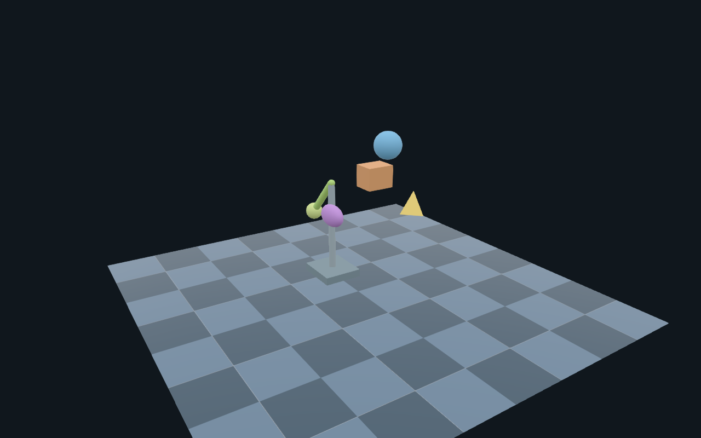
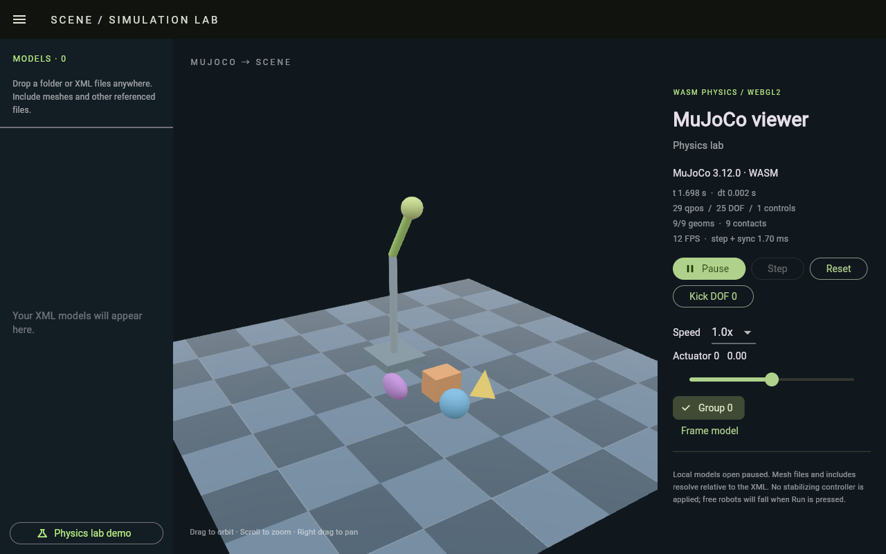
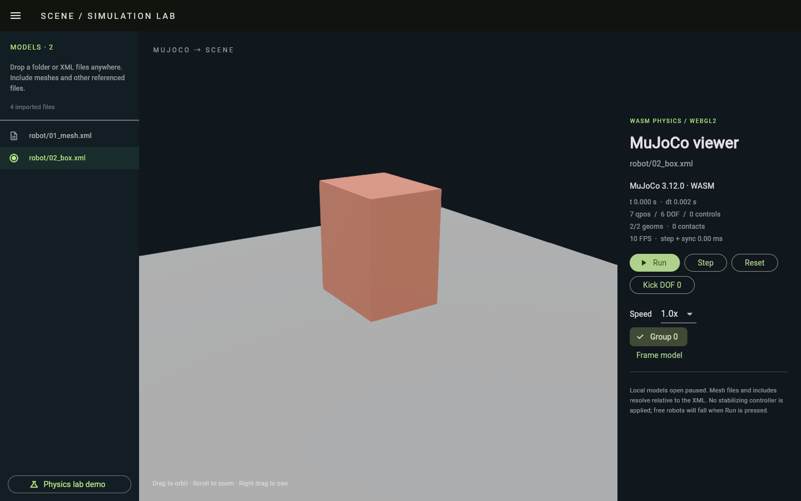

# MuJoCo / Flutter Scene Viewer Example

实际接入 `../../packages/` 下的四个包：

| 包 | 职责 |
| --- | --- |
| mujoco | 纯 Dart 数值 API、native FFI 与 JS/WASM 互操作，无 Python/Flutter 依赖 |
| mujoco_web | 官方 MuJoCo 3.12.0 JS/WASM 和浏览器加载器；资产仅打包到 Web |
| mujoco_flutter | 统一平台初始化与 Flutter AssetBundle 模型加载 |
| mujoco_viewer | 读取公共 geom/mesh/位姿接口的 Flutter Scene viewer |

本应用只负责面板和播放控制。示例内部的 `lib/simulation.dart` 管理固定步长和播放控制，场景、相机和 Widget 来自 `mujoco_viewer`，不再维护 native 指针渲染适配。完整分层说明见 [架构文档](../../docs/architecture.md)。

## 运行

Flutter 3.47.8 / Dart 3.13.7，native 与 WASM 引擎均为 MuJoCo 3.12.0。

```bash
flutter pub get
flutter run -d linux --enable-flutter-gpu
# 浏览器自动加载随包提供的 WASM，无需 Python、CDN 或手动 script 标签：
flutter run -d chrome
```

默认打开 `assets/physics_lab.xml`，包含电机摆、自由落体基本形状和 tetrahedron mesh。原生端可在面板输入 MJCF 路径；STL/include/texture 保持相对 XML 的目录结构。

```bash
flutter run -d linux --enable-flutter-gpu \
  --dart-define=MUJOCO_MODEL=/home/rx01321/桌面/robot/loong_gui_sim/runtime/model/LingLong2.0_20260616/LingLong_fullbody30.xml
```

浏览器不能直接读取原生磁盘路径；应用从 AssetBundle 或拖入的文件读取字节并填入 `MjVfs`，再调用 `MjModel.from_xml_path(path, vfs: vfs)`。`lib/model_path_*` 仅隔离演示的 native 路径输入。

## 拖入文件与切换模型

把 XML 文件、多个文件或完整模型文件夹拖入窗口。文件夹会递归读取，保留相对目录层级；建议直接拖入包含 XML、include、mesh 和 texture 的完整文件夹。资源只在本机内存和 VFS 中使用，不上传服务器。

XML 按相对路径排序，默认打开第一项；左侧 Models 侧边栏列出所有 XML，点击即可切换。窄窗口通过菜单打开同一列表。导入的模型默认暂停。每次拖入替换上一批导入文件；返回 Demo 后仍可从列表切回。某个 XML 编译失败时显示错误，仍可选择其他 XML。列表包含目录里的所有 XML，也可能包含仅用于 include 的片段。

文件读取在拖放回调结束前完成，之后切换模型不依赖浏览器临时句柄或原始磁盘文件。导入集合拥有共享 VFS，viewer 的 controller、model 和 data 在切换时分别释放。


## 操作与边界

拖拽环绕、滚轮缩放、右键平移；Run/Pause、单步、Reset、倍率、首执行器输入和 Group 显示开关。LingLong Group 1 是视觉 mesh，Group 3 是碰撞几何，默认隐藏 3 及以上组。

真实机器人暂停打开，未加载站立策略；Run 后是无控制物理运动。当前 viewer 支持基本形状与三角 mesh，尚未迁移原模型纹理、灯光、hfield/flex/tendon 和接触力可视化。带材质地面使用中性灰回退，与原生 MuJoCo checker 地面尚不一致。数值循环仍在 UI isolate，超载时会慢于实时。

## 验证

```bash
dart analyze --fatal-infos
flutter test --reporter expanded
dart run tool/native_smoke.dart
# MuJoCo 包的数值测试、AOT 裁剪检查在 ../../packages/mujoco 中运行：
# dart test
# dart run tool/verify_native_assets.dart
```

数值包 10 项、Flutter 资产加载 1 项、Viewer 2 项及本应用 6 项回归测试均通过。Linux 已实际显示 LingLong：37 qpos、36 DOF、30 controls、45 geoms、31 meshes。MuJoCo 数值 smoke 的进程未加载 libpython，本应用依赖图也已不包含 py_embed。

Web smoke 验证真实 WASM 物理步进、geom 位姿、控制数组、执行器/传感器元信息、VFS mesh、借用视图失效检查和 Flutter Scene 绘制。结果见 [web_smoke_result.json](docs/web_smoke_result.json)。

复现浏览器 smoke：

```bash
flutter build web --target tool/web_smoke_app.dart --no-wasm-dry-run
node tool/serve_web.mjs
# 另开终端，使用临时浏览器配置：
google-chrome --headless=new --no-sandbox --enable-unsafe-swiftshader \
  --remote-debugging-port=9228 --user-data-dir=/tmp/mujoco-web-smoke-chrome about:blank
node tool/run_web_smoke.mjs
```

四个包的代码、WASM 加载器、兼容补丁工具及上述静态服务器均不需要 Python。





常规应用已通过 `flutter build web --wasm`；Chromium 实际加载了 `main.dart.wasm` 与 MuJoCo WASM，仿真时间正常推进且未收集到运行时异常，记录见 [web_app_runtime.json](docs/web_app_runtime.json)。





默认示例的地面使用 MJCF 定义的棋盘格和十字标记。导入模型时，plane 显示模型编译后的 2D 纹理、颜色及重复设置；无纹理的地面保持原色。无限平面仍以有限可视区域显示。
